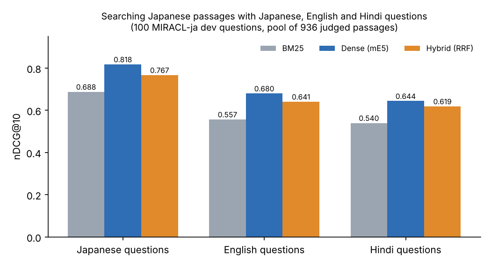

# crosslingual-search-ja

**Asking in English or Hindi, finding the answer in Japanese.**
A small research prototype that measures how much search quality drops when the same question is asked in English or Hindi instead of Japanese, and searched against Japanese text.

The motivation is practical. Many foreign residents in Japan need information that only exists in Japanese (city office pages, health insurance, visas). They ask in their own language. This project starts by measuring the size of that gap on a public benchmark, before trying to close it.

> **Status (October 2026):** first run done on 100 questions. The full 500-question run and a manual error analysis are next.

## First results

100 Japanese questions from the MIRACL dev set, machine-translated into English and Hindi with NLLB-200 (beam 2). All three systems search the same pool of 936 judged Japanese passages. Run on a MacBook CPU in 18.4 minutes.



| Questions | BM25 | Dense (multilingual-E5) | Hybrid (RRF) |
|---|---|---|---|
| Japanese | 0.688 | **0.818** | 0.767 |
| English | 0.557 (−19.0%) | **0.680** (−16.9%) | 0.641 (−16.4%) |
| Hindi | 0.540 (−21.5%) | **0.644** (−21.3%) | 0.619 (−19.3%) |

nDCG@10. The percentage is the drop compared with the same system using the original Japanese questions. Recall@20 and Recall@100 are in [`results/FIRST_RESULTS_100q.md`](results/FIRST_RESULTS_100q.md).

**What I learned so far**

1. Every system loses about 16–22% when the question is not in Japanese, and Hindi loses more than English.
2. The dense model (multilingual-E5) is the best in every language, even though it uses no translation at all.
3. Simple rank fusion did **not** help. It scored below the dense model alone, because BM25 is much weaker and pulls the merged list down. A weighted or learned fusion is worth testing.
4. In 15 questions the Japanese version found a correct passage in the top 10 but the Hindi version did not. These are the cases I am reading by hand first.

## How it works

```
MIRACL-ja dev questions (Japanese, with human relevance labels)
        │
        ├── NLLB-200 ──► English questions ──┐
        ├── NLLB-200 ──► Hindi questions   ──┤
        │                                    ▼
        │                  ┌─────────────────────────────────────┐
        │                  │ BM25: question translated back to   │
        │                  │       Japanese, character bigrams    │
        └─────────────────►│ Dense: multilingual-E5, no MT        │
                           │ Hybrid: reciprocal rank fusion (60)  │
                           └─────────────────────────────────────┘
                                             │
                                             ▼
                        nDCG@10, Recall@20, Recall@100 + failure lists
```

- **BM25** uses overlapping 2-character pieces, because Japanese has no spaces between words.
- **Dense** search uses `intfloat/multilingual-e5-small` with the `query:` / `passage:` prefixes. It puts all languages in one vector space.
- **Hybrid** merges the two ranked lists with reciprocal rank fusion (k = 60).

## Repository layout

```
run.py                 main experiment: load, translate, search, score
src/data.py            MIRACL-ja loading and the judged passage pool
src/translate.py       NLLB-200 translation with a cache
src/retrieval.py       BM25 (character bigrams), multilingual-E5, reciprocal rank fusion
src/metrics.py         nDCG@10, Recall@20, Recall@100
tests/test_offline.py  offline checks for the pieces above
results/               summary of the first run and the figure
```

## Run it

Python 3.10+, about 6 GB of disk. No GPU needed.

```bash
python -m venv .venv && source .venv/bin/activate   # Windows: .venv\Scripts\activate
pip install -r requirements.txt

python -m tests.test_offline                 # quick offline checks
python run.py --synthetic                    # fake data, checks the wiring (about 10 s)
python run.py --n-queries 100 --beams 2      # the run reported above (about 20 min on CPU)
python run.py                                # 500 questions, beam 4
```

Outputs go to `results/`: `summary.md`, `summary.csv`, `queries.tsv` (all questions and translations), `failures_en.tsv`, `failures_hi.tsv`, `translation_check.tsv` and `config.json`. Translations are cached, so a second run is much faster. This repository keeps only the summary of the first run; the per-question files will be added with the error analysis.

If MIRACL fails to load, install `datasets<4`; newer versions dropped the loader it uses.

## Limitations

- **Small pool, not the full corpus.** The full MIRACL Japanese corpus has about 6.9M passages. A pool of judged passages is a fair small test, but the numbers are not comparable with published full-corpus results.
- **Machine-translated questions.** They give known correct answers for free, but they do not sound exactly like real people. A small set of real questions from foreign residents is planned.
- **100 questions only.** Differences of a few points may not be significant yet.

## Next steps

1. Label the failed Hindi and English questions by error type (place names, katakana words, Japan-specific terms, bad translation).
2. Repeat with 500 questions and beam 4.
3. Test a small glossary of Japan-specific terms (for example 住民票, 国民健康保険) for query translation.
4. Try weighted fusion and a stronger dense model.
5. Check whether better retrieval also gives better answers in a simple RAG setup.

## References

1. X. Zhang et al., "MIRACL: A multilingual retrieval dataset covering 18 diverse languages," *TACL*, 2023.
2. NLLB Team, "No language left behind: Scaling human-centered machine translation," arXiv:2207.04672, 2022.
3. L. Wang et al., "Multilingual E5 text embeddings: A technical report," arXiv:2402.05672, 2024.
4. G. V. Cormack, C. L. A. Clarke and S. Büttcher, "Reciprocal rank fusion outperforms Condorcet and individual rank learning methods," in *Proc. SIGIR*, 2009.
5. S. Robertson and H. Zaragoza, "The probabilistic relevance framework: BM25 and beyond," *Foundations and Trends in IR*, 2009.

## Author

Sumit Kumar · [github.com/sumitk07](https://github.com/sumitk07)
